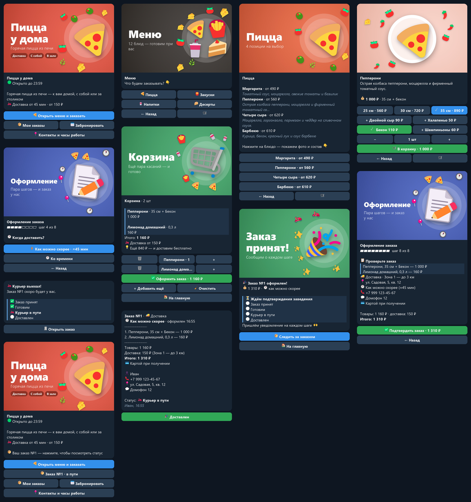

# 🍕 Telegram-бот для заказов в общепите

Демо-бот для пиццерии, кафе или кофейни. Один бот, в котором способы заказа
включаются и выключаются в `config.py`, — его можно быстро адаптировать под
конкретное заведение. В комплекте демо-данные вымышленной пиццерии «Пицца у дома».

**Стек:** Python 3.11+, aiogram 3, SQLite (aiosqlite), APScheduler.



<sub>Скриншоты сгенерированы `tools/preview_screens.py`: бот проходит сценарий на фейковом Telegram, экраны отрисованы в тёмной теме.</sub>

## Возможности

### Клиент
- **Главный экран** — баннер заведения, статус «открыто до 23:00», одна крупная кнопка «Открыть меню и заказать». Корзина с суммой и текущий заказ видны сразу. Показываются только включённые разделы.
- **Меню по категориям**: у каждого блюда фото, описание и цена.
- **Опции блюда**: размер с разной ценой (25 / 30 / 35 см) и добавки.
- **Корзина**: изменить количество, удалить позицию, итог и подсказка «ещё N ₽ — и доставим бесплатно».
- **Оформление**: способ получения → данные → комментарий → оплата → подтверждение.
- **Оплата**: онлайн через Telegram Payments (ЮKassa, тестовый режим), наличными или картой при получении.
- **Статусы заказа** приходят сообщениями с трекером: принят → готовим → готов к выдаче / курьер в пути → выдан / доставлен.
- **«Мои заказы»** с кнопкой «Повторить заказ» (по актуальным ценам, с учётом стоп-листа).
- **Вне часов работы** бот сообщает, что заведение закрыто, и предлагает заказ ко времени после открытия.

### Режимы заказа
| Режим | Что умеет |
|---|---|
| 🚚 Доставка | адрес, выбор зоны, стоимость доставки по зоне, минимальная сумма заказа, бесплатная доставка от суммы, «как можно скорее» или ко времени |
| 🏃 Самовывоз | «через 15 / 30 / 60 минут» или к конкретному времени |
| 🍽 За столиком | вход по ссылке `/start table_N` из QR-кода на столе, номер стола подставляется сам, оплата на месте |
| 📅 Бронь столика | дата, время, количество гостей, имя и телефон, подтверждение администратором |

### Персонал (рабочий чат)
- Каждый новый заказ приходит карточкой со всеми деталями и кнопкой следующего статуса.
- При нажатии клиенту уходит уведомление, а карточка обновляется на месте (видно, кто и когда изменил статус).
- «Отклонить» — с выбором причины; клиент получает её в уведомлении.
- Защита от двойных нажатий: два сотрудника не «перепрыгнут» через статус.
- Напоминание о заказе «ко времени» — когда пора начинать готовить.

### Администратор (`/admin`)
- Сводка за сегодня: заказы, выручка, средний чек, брони, стоп-лист.
- Список заказов и броней за сегодня.
- **Стоп-лист**: скрыть или вернуть блюдо одной кнопкой.
- **Рассылка** всем клиентам: текст или фото с подписью, с прогрессом и итогом.
- Подтверждение броней, ежедневный отчёт «Итоги дня».

### Интерфейс
- У каждого раздела свой баннер, а кнопки цветные (Bot API 9): синяя — главное действие экрана, зелёная — «В корзину», «Оформить», «Подтвердить», красная — «Отклонить». На старых клиентах Telegram кнопки просто обычные.
- Корзина с суммой доступна из любого места меню; при смене размера или добавки меняется только подпись — без мигания картинки.
- Бот редактирует одно сообщение, а не присылает новое на каждое нажатие. Введённые клиентом адрес и телефон удаляются, чтобы чат оставался чистым.
- Кнопка «Назад» на каждом шаге; корзина доступна из любого места меню.
- После правки шага с экрана подтверждения бот сразу возвращает к подтверждению, а не прогоняет все шаги заново.
- Адрес и телефон запоминаются — в следующий раз их можно выбрать одной кнопкой.

## Быстрый старт

```bash
git clone https://github.com/Nastyface144/restaurant-order-telegram-bot.git
cd restaurant-order-telegram-bot
python -m venv .venv
source .venv/bin/activate          # Windows: .venv\Scripts\activate
pip install -r requirements.txt
cp .env.example .env               # Windows: copy .env.example .env
```

Заполните `.env` и запустите:

```bash
python main.py
```

При первом запуске создаётся база `data/bot.db` с демо-меню (4 категории, 12 блюд).

### Что указать в `.env`

| Переменная | Где взять |
|---|---|
| `BOT_TOKEN` | [@BotFather](https://t.me/BotFather) → `/newbot` |
| `STAFF_CHAT_ID` | Создайте группу для персонала и добавьте в неё бота. ID группы можно узнать, например, через [@getmyid_bot](https://t.me/getmyid_bot); у групп он отрицательный (`-100…`) |
| `ADMIN_ID` | Ваш Telegram ID (тот же [@getmyid_bot](https://t.me/getmyid_bot)). Несколько администраторов — через запятую |
| `PAYMENT_TOKEN` | @BotFather → ваш бот → *Payments* → *ЮKassa* → тестовое подключение. Пусто — онлайн-оплата скрыта |

> Администратору нужно один раз написать боту `/start`, иначе бот не сможет присылать ему заявки на бронь и отчёты.

### Тестовая оплата

С тестовым токеном ЮKassa (вида `123456:TEST:abc`) деньги не списываются.
Оплачивайте тестовой картой из документации ЮKassa (раздел «Тестирование»),
например `5555 5555 5555 4477`, срок — любой будущий, CVC — любой.

### QR-коды для столов

```bash
python tools/table_links.py имя_вашего_бота
```

Скрипт выведет ссылки `https://t.me/<бот>?start=table_N` для всех столов. Если
установить `pip install "qrcode[pil]"`, он сохранит PNG с QR-кодами в `data/qr/`.

## Настройки заведения (`config.py`)

| Настройка | Что задаёт |
|---|---|
| `VENUE_NAME`, `VENUE_TAGLINE`, `VENUE_ADDRESS`, `VENUE_PHONE`, `VENUE_MAP_URL` | Название, подзаголовок, адрес, телефон, ссылка на карту |
| `TIMEZONE` | Часовой пояс заведения |
| `WORKING_HOURS` | Часы работы по дням недели; `None` — выходной; закрытие раньше открытия (10:00–02:00) — работа после полуночи |
| `ENABLE_DELIVERY`, `ENABLE_PICKUP`, `ENABLE_TABLE`, `ENABLE_BOOKING` | Включение режимов заказа |
| `ENABLE_ONLINE_PAYMENT`, `ENABLE_CASH_PAYMENT`, `ENABLE_CARD_ON_RECEIPT` | Способы оплаты |
| `DELIVERY_ZONES` | Зоны доставки: название, описание, стоимость, минимальный заказ, бесплатно от, время доставки |
| `DELIVERY_LEAD_MINUTES`, `PICKUP_LEAD_MINUTES` | Минимальное время до заказа «ко времени» |
| `PICKUP_QUICK_OPTIONS` | Кнопки «через N минут» для самовывоза |
| `TIME_SLOT_STEP_MINUTES` | Шаг сетки времени |
| `LAST_ORDER_BEFORE_CLOSE_MINUTES` | За сколько минут до закрытия перестаём принимать заказы |
| `TABLES_COUNT`, `TABLE_SESSION_HOURS` | Количество столов и сколько бот «помнит», что гость за столом |
| `BOOKING_DAYS_AHEAD`, `BOOKING_MAX_GUESTS`, `BOOKING_MIN_LEAD_MINUTES`, `BOOKING_LAST_BEFORE_CLOSE_MINUTES` | Ограничения брони |
| `BOOKING_REMINDER_MINUTES` | За сколько минут напомнить гостю о брони |
| `REJECT_REASONS` | Причины отклонения заказа (кнопки у персонала) |
| `SCHEDULED_ORDER_REMINDER_MINUTES` | За сколько минут напомнить кухне о заказе «ко времени» |
| `UNPAID_ORDER_TIMEOUT_MINUTES` | Через сколько минут отменить неоплаченный онлайн-заказ |
| `DAILY_REPORT_TIME` | Время ежедневного отчёта администратору (`None` — не отправлять) |

### Примеры адаптации

- **Кофейня без доставки:** `ENABLE_DELIVERY = False`, `ENABLE_BOOKING = False` — останутся самовывоз «через 15 минут» и заказ за столиком.
- **Только доставка:** `ENABLE_PICKUP = ENABLE_TABLE = ENABLE_BOOKING = False` — шаг выбора способа получения пропадёт сам.
- **Одна зона доставки:** оставьте одну зону в `DELIVERY_ZONES` — шаг выбора зоны пропадёт.

### Меню

Демо-меню лежит в `database/demo_data.py` и загружается в пустую базу. Чтобы
поставить своё меню, отредактируйте этот файл и удалите `data/bot.db`.
Поле `photo` — путь к файлу в `assets/`, URL или Telegram `file_id`. После первой
отправки бот кэширует `file_id`, поэтому фото не загружаются повторно.

Баннеры экранов (`assets/banners/`) и картинки блюд (`assets/menu/`) генерирует
`tools/generate_images.py` — название и адрес на баннерах берутся из `config.py`, поэтому
после смены названия перезапустите скрипт. Для реального заведения замените картинки
блюд фотографиями (соотношение 16:10, те же имена файлов).

## Структура проекта

```
main.py              точка входа: БД, роутеры, планировщик, polling
config.py            настройки заведения и чтение .env
handlers/            клиентские экраны и рабочий чат (роутеры aiogram)
  start.py           /start, главное меню, контакты, вход по QR стола
  menu.py            категории и карточка блюда
  cart.py            корзина
  checkout.py        оформление заказа
  payment.py         проверка перед оплатой, успешный платёж, отмена счёта
  my_orders.py       история и повтор заказа
  booking.py         бронь столика и решение администратора
  staff.py           кнопки статусов в рабочем чате
  errors.py          глобальный обработчик ошибок
  fallback.py        устаревшие кнопки и сообщения вне сценария
keyboards/           инлайн-клавиатуры и callback data
database/            SQLite: схема, репозитории, модели, демо-данные
orders/              бизнес-логика: часы работы, цены, шаги оформления,
                     статусы, уведомления, бронь, планировщик (APScheduler)
payments/            счёт Telegram Payments
admin/               /admin: сводка, стоп-лист, рассылка
utils/               «экран» из одного сообщения, форматирование, время
tools/               баннеры и картинки блюд, скриншоты экранов, ссылки для QR-кодов
tests/               тесты, включая сквозные сценарии на фейковом Telegram
```

## Надёжность

- Глобальный обработчик ошибок: при сбое пользователь видит понятное сообщение, бот продолжает работать.
- Перед созданием заказа повторно проверяются стоп-лист, выбранное время, минимальная сумма и сессия стола.
- Двойное нажатие «Подтвердить» не создаёт два заказа; статусы и брони меняются условными запросами к БД.
- Перед списанием денег бот сверяет заказ, владельца и сумму; повторное уведомление о платеже не дублирует заказ.
- Если рабочий чат недоступен, заказ всё равно оформляется, а администратор получает предупреждение.
- Клиенты, заблокировавшие бота, помечаются и не мешают рассылке.
- Корзина хранится в БД и переживает перезапуск; напоминания восстанавливаются из БД.

## Тесты

```bash
pip install -r requirements-dev.txt
pytest
```

Помимо модульных тестов (часы работы, цены, БД) есть сквозные сценарии: бот
работает целиком, а вместо сети запросы попадают в фейковый Telegram
(`tests/telegram_mock.py`), который запоминает сообщения и позволяет «нажимать
кнопки» по тексту.

## Ограничения демо

- Состояния диалогов (FSM) хранятся в памяти: после перезапуска незавершённое оформление начинается заново (корзина при этом сохраняется). Для продакшена подключите `RedisStorage`.
- Возврат денег за отклонённый оплаченный заказ оформляется вручную в личном кабинете ЮKassa — бот напоминает об этом в карточке заказа.
- Чеки по 54-ФЗ (`provider_data` с `receipt`) не передаются — в тестовом режиме они не нужны.
